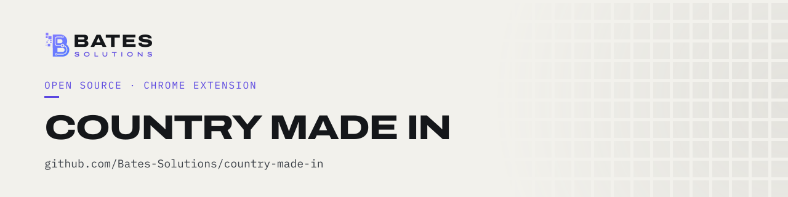

<a href="https://bates-solutions.com/?utm_source=github&utm_medium=readme&utm_campaign=country-made-in">
  <picture>
    <source media="(prefers-color-scheme: dark)" srcset=".github/assets/readme-banner-dark.svg">
    
  </picture>
</a>

# Country Made In

A Chrome extension that tells you where a product on Amazon is made, and shows you the evidence for
the answer instead of asking you to trust a flag.

[](https://github.com/Bates-Solutions/country-made-in/actions/workflows/ci.yml)
[](LICENSE)

On a supported Amazon product page, the extension reads the page you are actually looking at and
shows a badge beside the product title. Clicking it opens a panel with everything behind the
answer.

> **Status: early.** Origin detection works on product pages: the extension reads the page you are
> on, shows a badge beside the title and a panel with the evidence behind it. The wider search is
> not built yet, search-result tiles are not badged, and there is no Chrome Web Store listing, so
> install from source.

## Features

- **A verdict with a kind.** "Made in", "brand from" and "ships from" are three different
  questions with three different answers. They are reported separately rather than collapsed into
  one flag.
- **Evidence, always.** Every claim carries its source, its confidence and a link you can check
  yourself. Where sources disagree, you see the disagreement.
- **No flag unless we mean it.** Weak evidence shows as "origin unknown" rather than a flag with a
  caveat buried in a tooltip. The evidence is still one click away.

Supported marketplaces: `amazon.com` · `amazon.co.uk` · `amazon.ca` · `amazon.in` · `amazon.de` ·
`amazon.fr` · `amazon.it` · `amazon.es` · `amazon.co.jp`

## Install

It isn't in the Chrome Web Store yet. To install it from source, you need Node 22 (see `.nvmrc`):

```bash
npm ci
npm run build
```

Then load it in Chrome:

1. Open `chrome://extensions`.
2. Turn on **Developer mode**.
3. Choose **Load unpacked** and select the `dist/` directory.

### On WSL

Chrome loses an unpacked extension whenever the `\\wsl.localhost\…` path becomes unreadable. Build
onto the Windows filesystem instead:

```bash
COUNTRY_MADE_IN_DIST=/mnt/c/Users/you/country-made-in npm run build
```

The build **empties** that directory, so the path is validated before anything is written: it must
be absolute, must not contain the repo, and must be either empty or a previous build output.

## Limitations

Read these before trusting an answer:

- **Origin data on Amazon is seller-supplied.** It is frequently absent, sometimes stale, and
  occasionally wrong. The extension reports what the listing says; it cannot verify what the
  listing claims.
- **"Country of origin" is not one thing.** A product assembled in one country from components
  made in three others has no single honest answer. Where the listing is ambiguous, the extension
  says so rather than picking.
- **Absence of an answer is common and is not a failure.** Most listings simply do not state an
  origin. "Not stated" is a real result.
- **The same ASIN is a different product on different marketplaces.** Answers are scoped to the
  marketplace you are on and are not carried across.
- **A wider search, only if you ask: not built yet.** Looking beyond the current page costs time
  and needs extra permissions, so it will happen on a button press and never automatically.
- **Search-result tiles are not badged yet.**

## Privacy

There is no backend and no analytics. The extension keeps its answers in `chrome.storage.local`, in
your browser: up to 2,000 products, each for 30 days, or 7 days when it found no origin. Your
settings are in `chrome.storage.sync`, which Chrome syncs to your Google account if sync is on.
Nothing else leaves your browser. The wider search isn't built yet; when it is, it will send
requests only when you ask.

## Development

```bash
npm run dev        # Vite dev server with HMR
npm run lint       # ESLint
npm run typecheck  # tsc --noEmit
npm test           # Vitest
npm run format     # Prettier
```

Extraction and country resolution are pure functions tested against saved page fixtures. That is
deliberate: parsing correctness is the product, so it is the part with real tests.

CI (`.github/workflows/ci.yml`) runs lint, the format check, typecheck, tests and the build on
every push to `main` and every pull request into `main`.

## Security

Please report a vulnerability privately, as described in
[SECURITY.md](https://github.com/Bates-Solutions/.github/blob/main/SECURITY.md). Don't open a
public issue for it.

## Contributing

Contributions are welcome. See
[CONTRIBUTING.md](https://github.com/Bates-Solutions/.github/blob/main/CONTRIBUTING.md) and the
[code of conduct](https://github.com/Bates-Solutions/.github/blob/main/CODE_OF_CONDUCT.md).

## License

[MIT](LICENSE).

This is an independent implementation. It is not affiliated with, endorsed by, or connected to
Amazon, and it is not derived from any other origin-checking extension.

---

<a href="https://bates-solutions.com/?utm_source=github&utm_medium=readme&utm_campaign=country-made-in">
  <picture>
    <source media="(prefers-color-scheme: dark)" srcset="https://raw.githubusercontent.com/Bates-Solutions/.github/main/brand/bates-solutions-on-dark.svg">
    
  </picture>
</a>

Made by [Bates Solutions](https://bates-solutions.com/?utm_source=github&utm_medium=readme&utm_campaign=country-made-in).
